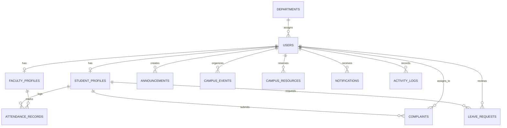

# Smart Campus Cloud Management System

[](https://www.oracle.com/java/)
[](https://spring.io/projects/spring-boot)
[](https://spring.io/projects/spring-security)
[](https://reactjs.org/)
[](https://www.mysql.com/)
[](https://www.docker.com/)
[](https://github.com/features/actions)

> **Enterprise Full-Stack Java Web Development Capstone Project**  
> A centralized, production-ready university management platform engineered with **Java 17**, **Spring Boot 3**, **Spring Data JPA**, **Spring Security 6 (JWT)**, **MySQL 8.0**, and **React 18**.

---

## 1. Project Title
**Smart Campus Cloud Management System** (Cloud-Native Academic & Operations Platform)

---

## 2. Project Overview
The **Smart Campus Cloud Management System** is a unified college ERP and student grievance operations platform designed to digitize end-to-end university workflows. It replaces legacy manual paper processes, fragmented spreadsheets, and siloed software with a responsive, role-based cloud platform.

The system caters to three core stakeholders:
1. **Students**: Track subject-wise attendance percentage in real-time, submit campus facility complaints with location tagging, apply for medical/academic leaves, register for campus events, and receive push notifications.
2. **Faculty**: Take attendance via an interactive bulk-marking roster, approve/reject student leave requests with custom remarks, triage student grievances, and broadcast academic circulars.
3. **Campus Administrators**: Monitor institutional analytics, manage student/faculty master directories, allocate physical infrastructure (smart labs, auditoriums, makerspaces), and audit immutable security logs.

---

## 3. Problem Statement
Traditional university operations suffer from:
- **Lack of Attendance Transparency**: Students often miss minimum 75% attendance criteria due to delayed manual registers.
- **Unresolved Campus Grievances**: Infrastructure defects (broken projectors, Wi-Fi outages, plumbing leaks) lack accountability and tracking.
- **Tedious Leave Approvals**: Manual leave forms take days to process between students, HODs, and advisors.
- **Fragmented Facilities Booking**: Double-booking of labs and seminar halls.
- **Absence of Auditability**: Administrative decisions and user actions are rarely logged centrally.

---

## 4. Objectives
- **Centralize University Lifecycle**: Consolidate attendance, complaints, leave, resources, and notices under a single unified architecture.
- **Ensure Role-Based Data Protection**: Restrict API and UI access strictly according to user permissions (`ROLE_STUDENT`, `ROLE_FACULTY`, `ROLE_ADMIN`) using Spring Security and stateless JWTs.
- **Cloud & Container Readiness**: Package all tiers into multi-stage Docker containers with automated health checks and zero-downtime orchestration.
- **Automated CI/CD Quality Control**: Implement GitHub Actions pipeline for automated compilation, unit testing, and Docker builds on every commit.

---

## 5. Key Features

### 🎓 Student Features
- **Student Dashboard**: Real-time aggregate attendance gauge, active complaint status milestones, and upcoming event tickets.
- **Attendance Center**: Subject-wise percentage breakdown (Present, Absent, Late), danger alerts for $<75\%$ shortage, and date-by-date daily logs.
- **Grievance Triage**: Lodge maintenance tickets across 8 categories (Infrastructure, Electrical, Water, Internet, Classroom, Hostel, Transport, Other) with priority and location tags.
- **Leave Applications**: Apply for multi-day leaves with automatic date validation and track advisor remarks.
- **Campus Hub**: Explore and register for inter-college hackathons, guest lectures, and cultural galas.
- **Notification Drawer**: Real-time alerts on attendance warnings, leave approvals, and circulars.

### 👨‍🏫 Faculty Features
- **Interactive Class Attendance**: Dynamic student roster grid with 1-click toggles (Present / Absent / Late) and real-time head-count counters.
- **Leave Review Queue**: Review student leave applications with 1-click **Approve** or **Reject** modals and feedback remarks.
- **Issue Triage**: Update grievance statuses to *In Progress*, *Resolved*, or *Rejected* with technician dispatch notes.
- **Student Directory**: Inspect assigned student profiles, CGPA metrics, and emergency guardian contacts.
- **Announcements**: Publish circulars with priority flags and target audience filters.

### ⚡ Administrator Features
- **Executive Cloud Dashboard**: Live charts of grievance distribution by category, department student enrollment bar charts, and container health metrics.
- **User Master Directory**: Activate/Deactivate student and faculty accounts.
- **Campus Facility Manager**: Reserve, allocate, and release smart computer labs, conference rooms, auditoriums, and makerspaces.
- **Security Audit Logs**: Immutable audit trail capturing timestamp, user email, entity, action type, and client IP address.

---

## 6. User Roles & Access Matrix

| Module / Action | Student | Faculty | Admin |
| :--- | :---: | :---: | :---: |
| **Self Registration & Profile View** | ✅ | ✅ | ✅ |
| **View Subject Attendance & Percentage** | ✅ (Own) | ✅ (All Dept) | ✅ (All) |
| **Mark Class Attendance** | ❌ | ✅ | ✅ |
| **Lodge Grievance / Complaint** | ✅ | ❌ | ❌ |
| **Update Complaint Status & Notes** | ❌ | ✅ | ✅ |
| **Submit Leave Request** | ✅ | ❌ | ❌ |
| **Approve / Reject Leave Request** | ❌ | ✅ | ✅ |
| **Publish Campus Announcements** | ❌ | ✅ | ✅ |
| **Create Campus Events** | ❌ | ✅ | ✅ |
| **Book / Release Campus Resources** | ❌ | ❌ | ✅ |
| **View System Audit Trail & Logs** | ❌ | ❌ | ✅ |

---

## 7. Technology Stack

```
 Frontend (React 18 + Vite)
      │  (HTTPS / REST JSON)
      ▼
 Backend (Java 17 + Spring Boot 3.3.2)
      │  (Spring Security + JWT)
      ▼
 Database (MySQL 8.0 / Hibernate ORM)
```

- **Frontend**: React 18, Vite, Vanilla CSS Design System, Lucide React Icons, Axios, Canvas Confetti.
- **Backend**: Java 17+, Spring Boot 3.3.2, Spring MVC, Spring Data JPA (Hibernate), Spring Security 6, JJWT (io.jsonwebtoken 0.11.5), Maven.
- **Database**: MySQL 8.0 (Production / Docker), H2 In-Memory (Test profile).
- **Containerization**: Docker, Docker Compose, Multi-stage builds, Nginx.
- **Testing**: JUnit 5, Mockito, Spring Boot Test, AssertJ, MockMvc.
- **CI/CD**: GitHub Actions (`.github/workflows/ci.yml`).

---

## 8. System Architecture Diagram

```
                     ┌──────────────────────────────────────────────┐
                     │          CLIENT BROWSER (REACT 18)           │
                     │  - Role Guarded Routes (/student, /faculty) │
                     │  - Axios Bearer Interceptor & Context State │
                     └──────────────────────┬───────────────────────┘
                                            │ HTTP / REST APIs
                                            ▼
                     ┌──────────────────────────────────────────────┐
                     │              NGINX REVERSE PROXY             │
                     │          Port 80 / Reverse Proxy             │
                     └──────────────────────┬───────────────────────┘
                                            │
                                            ▼
                     ┌──────────────────────────────────────────────┐
                     │       SPRING BOOT 3 REST API BACKEND         │
                     │  ┌────────────────────────────────────────┐  │
                     │  │ JwtAuthenticationFilter & SecurityCtx   │  │
                     │  └───────────────────┬────────────────────┘  │
                     │                      ▼                       │
                     │  ┌────────────────────────────────────────┐  │
                     │  │ Controllers (Auth, Student, Faculty)    │  │
                     │  └───────────────────┬────────────────────┘  │
                     │                      ▼                       │
                     │  ┌────────────────────────────────────────┐  │
                     │  │ Services Layer (Business Rules & Calc) │  │
                     │  └───────────────────┬────────────────────┘  │
                     │                      ▼                       │
                     │  ┌────────────────────────────────────────┐  │
                     │  │ Spring Data JPA Repositories (ORM)     │  │
                     │  └───────────────────┬────────────────────┘  │
                     └──────────────────────┼───────────────────────┘
                                            │ JDBC / SQL
                                            ▼
                     ┌──────────────────────────────────────────────┐
                     │               MYSQL 8.0 CLUSTER              │
                     │  - Users, Profiles, Attendance Records       │
                     │  - Complaints, Leaves, Resources, Audit Logs │
                     └──────────────────────────────────────────────┘
```

---

## 9. Database Architecture (Entity Relationship)



### Entity Schema Summary
1. `users`: ID, email, password (BCrypt), full_name, role (`ROLE_STUDENT`, `ROLE_FACULTY`, `ROLE_ADMIN`), phone_number, department_id, active, created_at.
2. `student_profiles`: ID, user_id (FK), roll_number, admission_number, semester, batch, cgpa, guardian_name, guardian_contact.
3. `faculty_profiles`: ID, user_id (FK), employee_code, designation, qualification, specialization.
4. `departments`: ID, name, code (`CSE`, `ECE`, `MECH`, `IT`), building_location.
5. `attendance_records`: ID, student_id (FK), faculty_id (FK), subject, attendance_date, status (`PRESENT`, `ABSENT`, `LATE`), remarks.
6. `complaints`: ID, complaint_code, student_id (FK), category, title, description, location, priority, status, assigned_to_user_id (FK), resolution_remarks.
7. `leave_requests`: ID, student_id (FK), start_date, end_date, reason, status (`PENDING`, `APPROVED`, `REJECTED`), reviewed_by_user_id (FK), faculty_remarks.
8. `announcements`: ID, title, description, department_id (FK), priority, target_role, created_by_user_id (FK).
9. `campus_events`: ID, event_name, description, event_date, time, venue, organizer, max_participants, registered_count.
10. `campus_resources`: ID, resource_name, resource_type, location, capacity, status (`AVAILABLE`, `OCCUPIED`, `MAINTENANCE`), booked_by_user_id (FK), booking_purpose.
11. `notifications`: ID, user_id (FK), title, message, type, is_read, link, created_at.
12. `activity_logs`: ID, user_email, action, entity_name, entity_id, details, ip_address, timestamp.

---

## 10. Project Directory Structure

```
smart-campus-cloud-java/
├── backend/
│   ├── pom.xml
│   ├── Dockerfile
│   └── src/
│       ├── main/
│       │   ├── java/com/smartcampus/
│       │   │   ├── SmartCampusApplication.java
│       │   │   ├── config/
│       │   │   │   ├── SecurityConfig.java
│       │   │   │   ├── CorsConfig.java
│       │   │   │   └── DataInitializer.java
│       │   │   ├── security/
│       │   │   │   ├── JwtTokenProvider.java
│       │   │   │   ├── JwtAuthenticationFilter.java
│       │   │   │   ├── UserDetailsServiceImpl.java
│       │   │   │   ├── UserPrincipal.java
│       │   │   │   └── AuthEntryPointJwt.java
│       │   │   ├── entity/ (19 Entity & Enum Classes)
│       │   │   ├── repository/ (12 JPA Repositories)
│       │   │   ├── dto/ (12 Request/Response Data Objects)
│       │   │   ├── service/ (12 Business Services)
│       │   │   ├── controller/ (8 REST API Controllers)
│       │   │   └── exception/ (GlobalExceptionHandler)
│       │   └── resources/
│       │       ├── application.properties
│       │       └── application-test.properties
│       └── test/java/com/smartcampus/
│           ├── controller/AuthControllerTest.java
│           └── service/
│               ├── AuthServiceTest.java
│               ├── AttendanceServiceTest.java
│               ├── ComplaintServiceTest.java
│               └── LeaveServiceTest.java
├── frontend/
│   ├── package.json
│   ├── vite.config.js
│   ├── index.html
│   ├── Dockerfile
│   ├── nginx.conf
│   └── src/
│       ├── index.css
│       ├── App.jsx
│       ├── main.jsx
│       ├── context/ (AuthContext, NotificationContext)
│       ├── services/ (api.js, authService, studentService, facultyService, adminService, mockData)
│       ├── components/ (Navbar, Sidebar, StatCard, StatusBadge, DataTable, Modal, LoadingSpinner, PageHeader)
│       └── pages/
│           ├── Login.jsx & Register.jsx
│           ├── student/ (Dashboard, Attendance, Complaints, Leave)
│           ├── faculty/ (Dashboard, Attendance, Leave, Complaints, Students)
│           ├── admin/ (Dashboard, Students, Faculty, Complaints, Leave, Resources, Logs)
│           └── common/ (AnnouncementsPage, EventsPage, NotificationsPage, ProfilePage, NotFound)
├── .github/
│   └── workflows/ci.yml
├── docker-compose.yml
├── .env.example
├── .gitignore
└── README.md
```

---

## 11. REST API Documentation Overview

### Authentication (`/api/auth`)
- `POST /api/auth/login`: Authenticate email/password $\rightarrow$ Returns JWT Bearer token & user profile.
- `POST /api/auth/register`: Register new student or faculty account.
- `GET  /api/auth/me`: Get current authenticated user session details.

### Student Module (`/api/students`)
- `GET  /api/students/dashboard`: Student aggregate metrics and attendance percentage.
- `GET  /api/students/attendance`: Subject-wise attendance calculation.
- `GET  /api/students/attendance/history`: Daily date-by-date attendance logs.
- `GET  /api/students/complaints`: List student submitted complaints.
- `POST /api/students/complaints`: Lodge new grievance ticket.
- `GET  /api/students/leave`: List student leave requests.
- `POST /api/students/leave`: Submit leave request.

### Faculty Module (`/api/faculty`)
- `GET  /api/faculty/dashboard`: Faculty KPI metrics and pending tasks.
- `GET  /api/faculty/students`: Assigned students roster with CGPA.
- `POST /api/faculty/attendance`: Batch mark lecture attendance.
- `GET  /api/faculty/leave-requests`: Department leave requests to review.
- `PUT  /api/faculty/leave-requests/{id}`: Approve or reject leave request.
- `GET  /api/faculty/complaints`: Campus complaints to triage.
- `PUT  /api/faculty/complaints/{id}`: Update grievance status & remarks.

### Admin Module (`/api/admin`)
- `GET  /api/admin/dashboard`: Institutional overview & distribution charts.
- `GET  /api/admin/students`: Enrolled student master list.
- `GET  /api/admin/faculty`: Teaching staff directory.
- `GET  /api/admin/departments`: Academic departments.
- `PUT  /api/admin/users/{id}/toggle-status`: Enable or disable user access.
- `GET  /api/admin/logs`: Audit trail logs.

### Shared Modules (`/api/announcements`, `/api/events`, `/api/resources`, `/api/notifications`)
- `GET  /api/announcements`: List announcements feed.
- `POST /api/announcements`: Publish announcement (Faculty/Admin).
- `GET  /api/events`: Upcoming campus events calendar.
- `POST /api/events/{id}/register`: Register participant for event.
- `GET  /api/resources`: Campus facilities list & booking status.
- `POST /api/resources/{id}/book`: Reserve lab or auditorium.
- `POST /api/resources/{id}/release`: Release occupied facility.
- `GET  /api/notifications`: User notifications.
- `PUT  /api/notifications/{id}/read`: Mark notification as read.

---

## 12. Authentication & Security Implementation
- **Password Protection**: Passwords are never stored in plaintext; hashed via `BCryptPasswordEncoder` with strength factor 10.
- **JWT Authorization**: Requests send an HTTP Header `Authorization: Bearer <token>`.
- **Stateless Sessions**: Session creation policy is set to `SessionCreationPolicy.STATELESS`.
- **Method-Level Security**: Controllers enforce `@PreAuthorize("hasRole('ADMIN')")` or `@PreAuthorize("hasAnyRole('FACULTY', 'ADMIN')")`.

---

## 13. Docker & Docker Compose Setup (1-Click Startup)

### Prerequisites
- Docker Desktop installed and running.

### Launch Application
```bash
# Clone or navigate to the project directory
cd smart-campus-cloud-java

# Build and start all 3 containers (MySQL + Spring Boot + React)
docker compose up --build
```

### Access Points
- **Frontend Web UI**: `http://localhost:80` (or `http://localhost:5173`)
- **Backend REST API**: `http://localhost:8080/api`
- **MySQL Database**: `localhost:3306`

---

## 14. Local Development Setup (Manual Run)

### Backend (Spring Boot):
```bash
cd backend

# Run with Maven and explicitly enable sample data for local demos
mvn spring-boot:run -Dspring-boot.run.profiles=dev
```
*Backend starts on `http://localhost:8080`. Demo seed data is loaded only when the `dev` Spring profile is active. Without that profile, sample admin/faculty/student accounts are not created.*

### Frontend (React):
```bash
cd frontend

# Install dependencies
npm install

# Start Vite dev server
npm run dev
```
*Frontend starts on `http://localhost:5173`.*

---

## 15. Testing Suite

### Run Backend Unit & Integration Tests:
```bash
cd backend
mvn test
```
The test suite validates:
- `AuthServiceTest`: Login success, JWT generation, duplicate email rejection.
- `AttendanceServiceTest`: Accurate percentage calculation, status breakdown.
- `ComplaintServiceTest`: Ticket creation, status updates, notification triggers.
- `LeaveServiceTest`: Date validation, approval workflow.
- `AuthControllerTest`: MockMvc HTTP 200 response and JSON payload serialization.

---

## 16. GitHub Actions CI/CD Pipeline
Every push and pull request triggers `.github/workflows/ci.yml`:
1. Checkout source code.
2. Setup Java 17 Temurin & cache Maven repository.
3. Execute `mvn clean test` and verify 100% test pass rate.
4. Setup Node.js 20 & install frontend dependencies.
5. Compile production React bundle with Vite (`npm run build`).
6. Build Docker images for Backend & Frontend to ensure container integrity.

---

## 17. Cloud Deployment Guide (AWS Architecture)

```
                            AWS CLOUD ARCHITECTURE
                            
             Users (Internet)
                    │
                    ▼
          [Amazon CloudFront CDN]
                    │
                    ▼
            [Amazon S3 Bucket]  ── (React 18 Static Web Hosting)
                    │
             /api/* REST Calls
                    ▼
         [Application Load Balancer]
                    │
                    ▼
     [AWS ECS / Fargate Container Cluster]
      └── Docker Container: Spring Boot 3 Java API
                    │
                    ▼ (Private Subnet VPC)
     [Amazon RDS for MySQL (Multi-AZ)]
      └── Database Instance: smart_campus_db
```

### Deployment Steps on AWS:
1. **Frontend Hosting**:
   - Run `npm run build` inside `frontend/`.
   - Upload `dist/` contents to an **Amazon S3** bucket configured for static website hosting.
   - Configure **Amazon CloudFront** distribution with SSL certificate from AWS Certificate Manager (ACM).
2. **Backend Container Hosting**:
   - Push Backend Docker image to **AWS Elastic Container Registry (ECR)**:
     ```bash
     aws ecr get-login-password --region us-east-1 | docker login --username AWS --password-stdin <aws-account-id>.dkr.ecr.us-east-1.amazonaws.com
     docker build -t smart-campus-backend ./backend
     docker tag smart-campus-backend:latest <aws-account-id>.dkr.ecr.us-east-1.amazonaws.com/smart-campus-backend:latest
     docker push <aws-account-id>.dkr.ecr.us-east-1.amazonaws.com/smart-campus-backend:latest
     ```
   - Create an **AWS ECS Task Definition** (Fargate launch type, 0.5 vCPU, 1GB RAM).
   - Point environment variables (`DB_HOST`, `DB_USER`, `DB_PASSWORD`, `JWT_SECRET`) to **AWS Systems Manager Parameter Store** or **Secrets Manager**.
3. **Database**:
   - Provision an **Amazon RDS for MySQL 8.0** instance inside a private VPC subnet with automatic backups enabled.

### Simple 1-Click Free Cloud Deployment (For College Demo):
- **Frontend**: Deploy on **Vercel** or **Netlify** with root directory `frontend`.
- **Backend**: Deploy on **Render.com** or **Railway.app** using the Dockerfile.
- **Database**: Free MySQL on **Aiven** or **Railway MySQL**.

---

## 18. Demo Mode and Local-Only Accounts

Demo accounts are created by the backend seed initializer only when the `dev` Spring profile is explicitly enabled. Their login details are intentionally not published here. Use only disposable local databases for demos.

For a local UI walkthrough, set `VITE_DEMO_MODE=true` in the frontend environment before building. This enables mock fallback and demo-only login/role-switch controls. Keep `VITE_DEMO_MODE=false` (or unset) for staging and production builds. Run the backend with `SPRING_PROFILES_ACTIVE=dev` only in local development; do not enable this profile against production data.

The frontend flag controls demo UI only and is not a security boundary. The production backend must still use real authentication and authorization.

---

## 19. Future Enhancements
- **Face Recognition Attendance**: Integrate OpenCV/Python AI microservice for automated biometric lecture attendance.
- **Push Notifications with WebSockets**: Real-time instant messaging using Spring Boot WebSockets and STOMP protocol.
- **Fee Payment Gateway Integration**: Razorpay / Stripe integration for tuition and hostel fee reconciliation.
- **AI Smart Timetable Generator**: Genetic algorithm based classroom scheduler preventing faculty collisions.

---

## 20. Author & Project Metadata
- **Project Name**: Smart Campus Cloud Management System
- **Domain**: Full Stack Java Web Development & Cloud Architecture
- **Frameworks**: Java 17, Spring Boot 3.3.2, Spring Security 6, React.js 18, MySQL 8
- **License**: MIT Academic License
